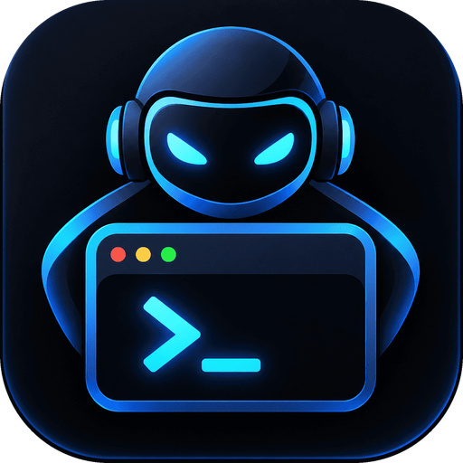

<div align="center">



# Odesk Agent

**Gestiona todos tus proyectos desde una sola ventana: terminales reales, CLIs de IA y un asistente de agentes integrado.**

Electron · Vite · React · TypeScript · xterm.js · node-pty

[⚠️ Obligatorio](OBLIGATORIO.md) · [Instalación](#instalación) · [Actualizar](#actualizar) · [Características](#características) · [Desarrollo](#desarrollo) · [Documentación](#documentación)

</div>

> **⚠️ Antes de usarlo en varias computadoras lee [OBLIGATORIO.md](OBLIGATORIO.md)** — sobre todo: sube `.odesk/project.json` a git en cada proyecto.

---

## Características

- **Terminales reales** (xterm.js + node-pty) organizadas por proyecto y grupo, con rejilla en árbol de divisiones (como tmux/VSCode), pestañas por grupo y ventanas separables sin reiniciar los procesos.
- **Proveedores de IA**: lanza Claude Code, Codex, Gemini, Ollama… dentro de la terminal de un proyecto con un clic (✦).
- **Agentes y skills de Claude Code**: biblioteca compartida o por proyecto, activable por grupo; se inyecta como plugin sin tocar el repositorio.
- **Caveman integrado**: toda terminal de Claude Code y el Asistente cargan [Caveman](https://github.com/JuliusBrussee/caveman) (respuestas comprimidas, ~75 % menos tokens) con cualquier cuenta; la app lo descarga de GitHub a `~/.odesk-agent/caveman/` y lo actualiza sola (al arrancar y cada 6 h). Requiere `git` y `node` en el PATH; `ODESK_SIN_CAVEMAN=1` lo desactiva.
- **Asistente integrado**: núcleo de agentes propio sobre la API de Anthropic, con subagentes, herramientas, cliente MCP, memoria corta y larga, flujos en git worktrees, guardrails, confirmación humana, permisos persistentes, comandos con `/`, trazas y evals.
- **Tareas por grupos y proyectos** (tablero, lista, resumen y actividad) que la IA también lee y cambia con las mismas reglas: criterios de aceptación, dependencias, estados configurables e historial de quién hizo qué.
- **Control de versiones con git** por proyecto: cambios y diff, commits, historial, ramas y fusiones, versiones (etiquetas con la siguiente versión semántica sugerida), stash y sincronización con el remoto.
- **GitHub y git en el chat**: el asistente puede consultar y confirmar cambios, crear ramas, abrir pull requests y revisar incidencias y CI (con `/commit` y `/pr`); la pantalla Versiones conecta tu cuenta con un token (guardado cifrado), clona, publica y gestiona pull requests.
- **Navegador integrado**: abre lo que desarrollas en una ventana con barra de direcciones y herramientas de desarrollo, detecta los servidores locales en marcha y también lo abre en el navegador del sistema.
- **Cliente API** (estilo Postman): peticiones HTTP con entornos (`{{variables}}`), colecciones, historial, importar/copiar cURL y la respuesta con el JSON en árbol.
- **Editor de archivos** (CodeMirror 6) en cada celda, con árbol del proyecto, pestañas y guardado automático.
- **Seguro por defecto**: `contextIsolation`, `sandbox` y CSP activos; las credenciales se redactan en las trazas.

## Instalación

Un solo comando descarga e instala todo lo necesario (Node.js y pnpm si no los tienes, dependencias, compilación, lanzador y acceso directo). Todo queda dentro de tu usuario: en Linux solo pide `sudo` una vez para configurar el sandbox de Electron.

### Linux y macOS

```bash
curl -fsSL https://raw.githubusercontent.com/millerbermeo/terminal-desk/main/install.sh | bash
```

### Windows (PowerShell)

```powershell
powershell -NoProfile -ExecutionPolicy Bypass -Command "irm https://raw.githubusercontent.com/millerbermeo/terminal-desk/main/install.ps1 | iex"
```

Después ejecuta `odesk` en una terminal nueva, o ábrela desde el menú de aplicaciones (Linux) / menú Inicio (Windows).

### Requisitos previos

| Sistema | Necesitas tener | Comando |
|---|---|---|
| Debian / Ubuntu | `git`, `curl`, herramientas de compilación | `sudo apt install git curl build-essential python3` |
| Fedora | ídem | `sudo dnf install git curl gcc-c++ make python3` |
| Arch | ídem | `sudo pacman -S git curl base-devel python` |
| macOS | `git` (Xcode Command Line Tools) | `xcode-select --install` |
| Windows | `git` | `winget install --id Git.Git -e` |

Node.js 20+ y pnpm **no** hacen falta: si no existen, el instalador descarga un Node.js LTS verificado por checksum y pnpm dentro de la carpeta de instalación. En Linux las herramientas de compilación sirven para `node-pty`; en macOS y Windows se usan binarios precompilados.

### Qué hace el instalador

1. Comprueba dependencias y, si hace falta, descarga Node.js y pnpm en una carpeta privada.
2. Clona el repositorio en `~/.local/share/odesk-agent` (Windows: `%LOCALAPPDATA%\odesk-agent`). Si ya tenías la app instalada con el nombre anterior (`centro-proyectos`), se actualiza donde estaba, sin moverla.
3. Instala dependencias, prepara Electron, compila `node-pty` si procede y construye la app.
4. Crea el lanzador `~/.local/bin/odesk` y la entrada del menú de aplicaciones.
5. Deja `servidor-por-defecto.txt` junto a la carpeta `repo/`: la app instalada se conecta a **https://odesk.millerrivera.com** (ver «Servidor» más abajo).

Variables opcionales: `ODESK_DIR` (carpeta de instalación), `ODESK_BIN` (carpeta del lanzador, solo Linux/macOS), `ODESK_REPO` (repositorio), `ODESK_REF` (rama, etiqueta o commit a instalar) y `ODESK_SERVIDOR` (servidor al que se conecta la app por defecto; sin ella, `https://odesk.millerrivera.com`). Las antiguas `CENTRO_DIR`, `CENTRO_BIN`, `CENTRO_REPO` y `CENTRO_REF` siguen funcionando.

### Servidor

La app necesita el servidor (`terminal-desk--api`) para las cuentas, los proyectos y la sincronización. La dirección que usa, de mayor a menor prioridad:

1. La variable `ODESK_API_URL` (para forzar un servidor, por ejemplo en pruebas).
2. La que elijas en la pantalla de acceso con el botón **«cambiar»** (se guarda y se recuerda).
3. La de por defecto:
   - **App instalada** con el instalador, o empaquetada (`pnpm package`): `https://odesk.millerrivera.com`.
   - **Desarrollo** (`pnpm dev`): `http://localhost:3000`, tu backend local.

Se puede cambiar con `ODESK_SERVIDOR_POR_DEFECTO` en el entorno o editando `servidor-por-defecto.txt`.

## Actualizar

Vuelve a ejecutar **el mismo comando de instalación**, o bien:

```bash
odesk actualizar
```

El instalador detecta la instalación existente, consulta el repositorio y, si hay cambios, solo hace lo necesario: reconstruye la app y reinstala dependencias únicamente si cambió el lockfile. Si ya tienes la última versión termina en un segundo. Tus proyectos y ajustes (`~/.odesk-agent`) no se tocan. Cierra la app antes de actualizar.

Para instalar una versión concreta: `curl -fsSL …/install.sh | bash -s -- --ref v0.2.0`.

## Desinstalar

Un solo comando, igual que para instalar. Con la app instalada también sirve `odesk desinstalar`.

**Solo la app** (conserva tus proyectos y ajustes en `~/.odesk-agent`):

```bash
# Linux y macOS
curl -fsSL https://raw.githubusercontent.com/millerbermeo/terminal-desk/main/install.sh | bash -s -- --desinstalar
```
```powershell
# Windows (PowerShell)
powershell -NoProfile -ExecutionPolicy Bypass -Command "$env:CENTRO_UNINSTALL='1'; irm https://raw.githubusercontent.com/millerbermeo/terminal-desk/main/install.ps1 | iex"
```

**Todo, incluidos tus datos** (proyectos, proveedores, memoria, conversaciones; **no se puede deshacer**):

```bash
# Linux y macOS
curl -fsSL https://raw.githubusercontent.com/millerbermeo/terminal-desk/main/install.sh | bash -s -- --todo
```
```powershell
# Windows (PowerShell)
powershell -NoProfile -ExecutionPolicy Bypass -Command "$env:CENTRO_UNINSTALL='all'; irm https://raw.githubusercontent.com/millerbermeo/terminal-desk/main/install.ps1 | iex"
```

Se elimina la carpeta de instalación (incluidos el Node.js y pnpm privados), el lanzador, la entrada del menú de aplicaciones o el acceso del menú Inicio y la entrada del PATH de Windows. No toca cachés compartidas como el almacén de pnpm.

## Primeros pasos

1. Abre la app. Si no existe `~/.odesk-agent/proyectos.json`, se crea con datos de ejemplo.
2. Añade tus proyectos desde la barra lateral con **Abrir carpeta** (explorador nativo, admite varias carpetas) o **Agregar ruta** (escribe o pega una ruta, con autocompletado y botón «Examinar»). También puedes editar el archivo:

   ```json
   {
     "grupos": [{ "id": "trabajo", "nombre": "Trabajo" }],
     "proyectos": [{ "id": "api", "nombre": "API", "ruta": "/home/yo/dev/api", "grupo": "trabajo" }]
   }
   ```

   `grupo` es opcional. Se lee al iniciar (reinicia para ver cambios hechos a mano).
3. Haz clic en un proyecto para abrir su terminal, o pasa el ratón y pulsa ✦ para lanzar un CLI de IA.
4. Para usar el **Asistente** inicia sesión con tu cuenta de Claude desde su barra superior (modo suscripción, por defecto), o cambia a «API» y define `ANTHROPIC_API_KEY`.

## Uso

### Proveedores de IA

Un proveedor es un CLI que corre dentro de una terminal. Se gestionan en **Proveedores de IA** (barra lateral) y se guardan en `~/.odesk-agent/proveedores.json` (permisos 600; se crea con `claude`, `codex` y `gemini`).

```json
[{ "id": "claude", "nombre": "Claude Code", "comando": "claude --model sonnet", "env": { "VAR": "valor" } }]
```

- `comando` se escribe tal cual en el shell interactivo del proyecto: hereda PATH, nvm, etc. Al salir del CLI la terminal sigue viva.
- «No detectado» = el ejecutable no está en el PATH de la app; puede funcionar igual si tu shell lo carga.
- `env` se guarda en texto plano: si ya iniciaste sesión en el CLI no hace falta poner claves.

### Agentes y skills (Claude Code)

Pantalla **Agentes y skills**, guardada en `~/.odesk-agent/agentes.json`.

- **Compartidos:** se definen una vez y se activan por **grupo** o por **proyecto** (lo del grupo se suma a lo del proyecto).
- **Individuales:** pertenecen a un proyecto y siempre se cargan en él.
- **Cuándo se aplican:** solo al abrir una terminal con Claude desde un proyecto (✦ → Claude Code). Una terminal normal, o escribir `claude` a mano, no los lleva.
- **Cómo:** la app genera un plugin en `~/.odesk-agent/sesiones/` y arranca `claude --plugin-dir <carpeta>`. No se escribe nada en el repositorio. Los subagentes aparecen como `centro:<nombre>`; las carpetas generadas se borran a los 14 días.
- Los cambios afectan a las terminales que abras después, no a las sesiones ya abiertas.

### Pestañas, ventanas y rejilla

- **Pestañas por grupo:** cada grupo se abre en su pestaña y las anteriores siguen vivas en segundo plano. ▶ en un grupo abre una terminal por proyecto; «+ Terminal» añade una extra; «+» (arriba) crea una pestaña suelta. Cerrar una pestaña (× o clic central) pide confirmación y cierra sus procesos.
- **Ventanas separadas:** arrastra una pestaña fuera de la barra (o usa ⧉) para abrirla en otra ventana; los procesos siguen vivos. «Devolver a la principal» la recupera. Cerrar la principal cierra toda la app.
- **Rejilla:** arrastra un divisor para mover esa línea (mínimo 260×150 px por terminal); doble clic lo centra; arrastra la barra de título sobre otra terminal para intercambiarlas; «Reorganizar» vuelve a la cuadrícula automática.

### Atajos y menú contextual

| Acción | Atajo |
|---|---|
| Copiar / Pegar | `Ctrl+Shift+C` / `Ctrl+Shift+V` |
| Copiar o interrumpir | `Ctrl+C` copia si hay selección; si no, envía SIGINT |
| Menú contextual | Clic derecho (Copiar, Pegar, Seleccionar todo, Limpiar). Con programas que usan el ratón (vim, tmux, htop) usa `Mayús`+clic derecho |

### Asistente

Pestaña **Asistente**: conversación con streaming, adjuntos (imágenes, PDF, texto), selector de modelo, medidor de contexto y consumo, trazas, memoria, ramas (worktrees), evals y confirmaciones humanas. Admite comandos propios con `/`, reglas de permisos persistentes y tres modos de autonomía (Preguntar / Ediciones / Autónomo) con presupuesto de tokens. Detalle en [docs/](docs/).

#### Cuenta: suscripción o API

La barra superior del Asistente elige con qué se paga el modelo:

| | Suscripción (por defecto) | API |
|---|---|---|
| Cuenta | Tu plan de Claude (Pro/Max), con la sesión del CLI `claude` | `ANTHROPIC_API_KEY` |
| Coste | Dentro de los límites de tu plan | Por tokens |
| Requisito | CLI `claude` instalado e **inicio de sesión** | Clave en el entorno o en el `env` del proveedor «claude» |
| Qué ejecuta el bucle | El CLI (sus herramientas y permisos) | El núcleo propio de la app |
| Flujos y grupos | No disponibles | Sí |

- **Iniciar sesión:** el botón «Iniciar sesión» abre el navegador (correo, Google o SSO), igual que en la extensión de VSCode. La app nunca ve tus credenciales: lo hace el CLI (`claude auth login`). Si no hay sesión, el Asistente no envía y te lo indica.
- **Varias cuentas:** «＋ Cuenta» añade otra cuenta de Claude (cada una con su propio inicio de sesión, aislada en `~/.odesk-agent/cuentas/<id>/`) y el selector cambia de cuenta. Con «Cambiar sola al llegar al límite», si la cuenta activa agota su límite de uso el mensaje continúa con otra cuenta con sesión (solo si aún no había ejecutado nada, para no repetir cambios) y la conversación se lleva sin reenviar el historial. Úsalo con cuentas tuyas (p. ej. trabajo y personal); rotar cuentas para esquivar límites puede ir contra los términos de Anthropic.
- **Permisos con suscripción:** el CLI no puede pedir confirmación en este modo, así que lo que requiere permiso se deniega. «Preguntar todo» = solo lectura; «Aceptar ediciones» permite modificar archivos; «Autónomo» añade las verificaciones del proyecto (typecheck, lint, test). Los comandos peligrosos no se ejecutan.
- La clave `ANTHROPIC_API_KEY` se ignora en modo suscripción para no cobrarte por tokens sin querer.
- Las terminales con Claude Code (✦) siempre usan la sesión del CLI, independientemente de esta opción.

## Datos de usuario

Todo se guarda en `~/.odesk-agent/`. Si venías de una versión anterior (la app se llamaba «Centro de Proyectos» y guardaba en `~/.centro-proyectos/`), esa carpeta se mueve sola a la nueva al abrir la app por primera vez: no se pierde nada y los worktrees de agentes que tuvieras se reparan. Si no se pudiera mover (permisos, archivos abiertos), la app sigue usando la carpeta antigua y lo deja anotado en el registro. Cierra otras instancias de la app antes de actualizar.


| Ruta | Contenido |
|---|---|
| `proyectos.json` | Proyectos y grupos |
| `proveedores.json` | Proveedores de IA (0600, `env` en texto plano) |
| `agentes.json` | Biblioteca de agentes y skills |
| `preferencias.json`, `sesiones-cli.json` | Proveedor elegido (suscripción/API) y sesiones del CLI para continuar conversaciones |
| `sesiones/` | Plugins generados para Claude Code |
| `github.json`, `askpass-github.*` | Token de GitHub **cifrado** con el llavero del sistema (0600) y el script con el que git se autentica (no contiene el token) |
| `api/` | Cliente API: colecciones, entornos (con sus tokens, sin cifrar; 0600) e historial |
| `tareas/`, `tareas.token`, `tareas.sock`, `mcp/` | Tareas (con su historial), credencial y socket local del servidor MCP de tareas y su configuración |
| `conversaciones/`, `memoria/`, `trazas/`, `evals/`, `permisos/`, `comandos/`, `worktrees/` | Estado del Asistente |

## Desarrollo

Requisitos: Node.js 20+, pnpm, y en Linux `build-essential python3`.

```bash
git clone https://github.com/millerbermeo/terminal-desk.git
cd terminal-desk
pnpm install
pnpm dev
```

| Comando | Descripción |
|---|---|
| `pnpm dev` | Electron en modo desarrollo (HMR solo en el renderer) |
| `pnpm build` | Compila a `out/` |
| `pnpm typecheck` | `tsc --noEmit` |
| `pnpm lint` | ESLint |
| `pnpm test` | Tests con vitest (LLM falso, git real en temporales, servidor MCP de prueba) |
| `pnpm evals` | Evals contra el modelo real (necesita `ANTHROPIC_API_KEY`; consume tokens) |
| `pnpm package` | Build + `electron-builder` (AppImage/deb, dmg, nsis en `dist/`) |

Notas:

- Los cambios en `src/main` o `src/preload` requieren reiniciar `pnpm dev`; el renderer se recarga solo (`Ctrl+R`).
- Si falla `node-pty` tras instalar o cambiar de Electron: `pnpm exec electron-rebuild -f -w node-pty`.
- Dentro de VSCode (`ELECTRON_RUN_AS_NODE=1`) lanza con `env -u ELECTRON_RUN_AS_NODE pnpm dev`.

### Estructura

```
src/main       proceso principal: ptys, proyectos, proveedores, archivos
src/main/core  núcleo de agentes propio (API de Anthropic, MCP, memoria, worktrees…)
src/preload    contextBridge + IPC tipado
src/renderer   React: Sidebar, TerminalGrid, Asistente, editor
src/shared     tipos IPC y modelos compartidos
tests/ evals/  pruebas y evaluaciones
docs/          documentación por fases
```

Añadir una operación IPC toca tres sitios: `src/shared/ipc.ts`, `src/preload/index.ts` y `registrarIpc()` en `src/main/index.ts`. Más contexto de arquitectura en [CLAUDE.md](CLAUDE.md).

## Solución de problemas

| Síntoma | Solución |
|---|---|
| `odesk: command not found` | Añade `~/.local/bin` al PATH (`export PATH="$HOME/.local/bin:$PATH"`) o abre una terminal nueva |
| Falla la compilación de `node-pty` (Linux) | Instala `build-essential python3` y repite el instalador |
| El instalador pide usuario/contraseña de GitHub | El repositorio debe ser público, o define `ODESK_REPO` con una URL accesible (por ejemplo SSH) |
| `The SUID sandbox helper binary was found, but is not configured correctly` | El instalador lo arregla pidiendo `sudo` una vez. Si no pudo, ejecuta `sudo chown root:root <instalación>/repo/node_modules/electron/dist/chrome-sandbox && sudo chmod 4755 <instalación>/repo/node_modules/electron/dist/chrome-sandbox` (`<instalación>` es `~/.local/share/odesk-agent`, o `~/.local/share/centro-proyectos` si la instalaste con el nombre anterior) o vuelve a lanzar el comando de instalación |
| `Cannot read properties of undefined (reading 'commandLine')` | Hay `ELECTRON_RUN_AS_NODE=1` en el entorno (el lanzador ya lo limpia) |
| Windows: no se compila `node-pty` | Instala Visual Studio Build Tools y Python 3 |

### Wayland

Main activa `--ozone-platform-hint=auto` (Electron elige Wayland o X11).

- Portapapeles: puede requerir que la ventana tenga foco. Si falla, prueba `--ozone-platform=x11`.
- Escalado fraccional (GNOME): texto borroso posible en XWayland; prueba `--enable-features=WaylandFractionalScaleV1`.
- El renderer WebGL cae a DOM automáticamente si falla la GPU.

## Seguridad

`contextIsolation: true`, `nodeIntegration: false`, `sandbox: true` y CSP en el HTML; el renderer solo accede a `window.api`. Eliminar un grupo exige la contraseña del usuario del sistema (viaja solo por stdin al proceso hijo). Los guardrails del Asistente vigilan credenciales, rutas fuera del proyecto y comandos destructivos.

Los instaladores se ejecutan sin privilegios (en Linux piden `sudo` solo para el `chrome-sandbox` de Electron), verifican por checksum el Node.js que descargan y solo escriben en tu carpeta de usuario. Revisa [install.sh](install.sh) / [install.ps1](install.ps1) antes de ejecutarlos si lo prefieres.

## Documentación

- [docs/fase-1.md](docs/fase-1.md) — agente, bucle, harness, subagentes, herramientas, cliente MCP
- [docs/fase-2.md](docs/fase-2.md) — monitor de contexto, memoria corta y larga
- [docs/fase-3.md](docs/fase-3.md) — grafo de estados, router de modelos, A2A
- [docs/fase-4.md](docs/fase-4.md) — worktrees, guardrails, confirmación humana
- [docs/fase-5.md](docs/fase-5.md) — trazas y evals
- [docs/interfaz.md](docs/interfaz.md) — editor de archivos y pestaña Asistente
- [docs/navegador-api.md](docs/navegador-api.md) — navegador integrado y cliente API
- [docs/versiones.md](docs/versiones.md) — control de versiones con git (cambios, historial, ramas, versiones, stash)
- [docs/tareas.md](docs/tareas.md) — tareas por grupos y proyectos, y su integración con la IA (MCP)
- [docs/permisos-autonomia-comandos.md](docs/permisos-autonomia-comandos.md) — permisos, autonomía y comandos `/`
